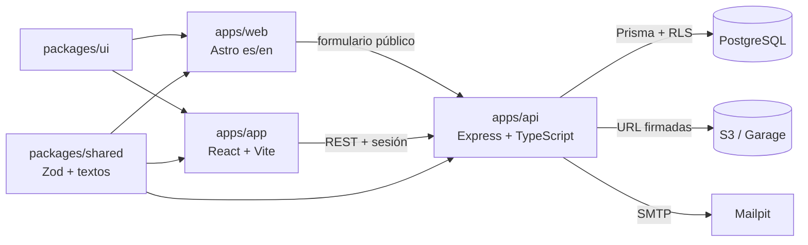

# Roofing Business Platform

Plataforma web completa para una empresa de roofing residencial en EE. UU.: sitio público bilingüe (es/en) y plataforma interna con portal de clientes, herramientas para empleados y administración.


> **¿Primera vez?** Abre la demo con [`COMO-INICIAR.md`](COMO-INICIAR.md) (un solo comando: `pnpm demo`) y entra con los usuarios de [`CREDENCIALES.md`](CREDENCIALES.md). Son usuarios ficticios para uso local.

## Funcionalidades

- **Sitio público bilingüe** (español/inglés) con portada cinematográfica y formulario de contacto protegido contra abuso.
- **Cuatro roles** (superadministrador, administrador, empleado y cliente) con invitaciones por correo y verificación en dos pasos (2FA) para los roles administrativos.
- **CRM**: leads con máquina de estados, propiedades y citas.
- **Inspecciones** con fotos guardadas en almacenamiento compatible con S3 mediante URL firmadas de corta duración.
- **Presupuestos**: catálogo, cálculo de paquetes, PDF generado con `@react-pdf/renderer` y aceptación por el cliente.
- **Proyectos y facturas** (pagos solo de demostración, no se cobra nada) y un panel con métricas.
- **Seguridad por fila (RLS)** en PostgreSQL: la API se conecta con roles que no saltan las políticas, con una matriz de pruebas de integración.
- Auditoría de acciones, cabeceras con Helmet, límites de tasa y validación con Zod compartida entre cliente y servidor.

## Stack

| Capa | Tecnología |
| --- | --- |
| Sitio público | Astro, React, Tailwind CSS 4 |
| Plataforma interna | React 19, Vite, React Router, TanStack Query, Motion |
| API | Node.js, Express 5, TypeScript, Better Auth, Zod |
| Datos | PostgreSQL 18, Prisma 7 (migraciones y RLS en SQL) |
| Almacenamiento y correo (desarrollo) | Garage (S3), Mailpit |
| Calidad | Vitest, Playwright, axe-core (accesibilidad), ESLint, Prettier, GitHub Actions |
| Monorepo | pnpm workspaces |

## Arquitectura



## Estructura

| Carpeta           | Qué es                                                         |
| ----------------- | -------------------------------------------------------------- |
| `apps/web`        | Sitio público (Astro), rutas `/es/` y `/en/`                   |
| `apps/app`        | Plataforma interna (React + Vite)                              |
| `apps/api`        | API (Node.js + Express + TypeScript)                           |
| `packages/ui`     | Sistema de diseño: tokens, componentes y movimiento            |
| `packages/shared` | Código compartido: esquemas Zod, utilidades y textos es/en     |
| `packages/config` | Configuración compartida de TypeScript y ESLint                |

## Cómo levantar el proyecto

Requisitos: Node 26 (ver `.nvmrc`), pnpm 12 y Docker Desktop.

```bash
pnpm install
cp .env.example .env
cp apps/api/.env.example apps/api/.env
docker compose up -d      # PostgreSQL y Mailpit
pnpm --filter @roofing/api db:deploy   # migraciones (con el dueño, DATABASE_URL)
pnpm --filter @roofing/api db:roles    # da LOGIN a app_user y app_system (seguridad por fila)
pnpm --filter @roofing/api db:seed     # opcional: superadmin y datos demo (SEED_DEMO=true)
pnpm demo:codigo                      # código 2FA de la demo (administrador y superadministrador)
pnpm dev                  # web, app y API en paralelo
```

La API se conecta con los roles `app_user` y `app_system`, que no saltan la seguridad por fila
(RLS); si se le da el usuario dueño o un superusuario, se niega a arrancar.

| Servicio            | URL                                      |
| ------------------- | ---------------------------------------- |
| Sitio público       | http://localhost:4321/es/                |
| Plataforma          | http://localhost:5173                    |
| Catálogo de diseño  | http://localhost:5173/componentes        |
| API                 | http://localhost:3000/api/health         |
| Correos de prueba   | http://localhost:8025 (Mailpit)          |
| Fotos (S3, Garage)  | http://localhost:3900 (solo con la API)  |

### Fotos de inspección (Garage)

Las fotos se guardan en un almacenamiento compatible con S3. En desarrollo es
[Garage](https://garagehq.deuxfleurs.fr/) (un solo nodo, bucket privado, solo escucha en
`127.0.0.1`; decisiones T28 y T29). La API nunca recibe los bytes: emite URL firmadas de 5 minutos.

```bash
docker compose up -d garage               # solo este servicio
pnpm --filter @roofing/api storage:init   # primera vez: nodo, bucket privado, clave de desarrollo y CORS
```

Las variables `S3_*` de `apps/api/.env.example` ya apuntan a este Garage. Sin ellas, las rutas de
fotos responden `503 STORAGE_NOT_CONFIGURED`. Las pruebas usan un almacenamiento falso en memoria.

## Calidad

```bash
# Los builds de producción exigen PUBLIC_SITE_URL (la web) y el e2e necesita el catálogo:
export PUBLIC_SITE_URL=https://example.com VITE_ENABLE_SHOWCASE=true
pnpm format:check && pnpm lint && pnpm typecheck && pnpm test && pnpm build
pnpm exec playwright install chromium   # solo la primera vez
pnpm test:e2e                           # accesibilidad y capturas en 390/834/1512 px
```

Pruebas de integración de la API (incluida la matriz de RLS), contra PostgreSQL:

```bash
pnpm --filter @roofing/api test:integration   # usa TEST_DATABASE_URL (nombre con "test")
```

La CI ejecuta lo mismo en cada PR hacia `dev` y `main`.

## Variables de entorno

Hay dos plantillas: [`.env.example`](.env.example) (servicios de Docker) y [`apps/api/.env.example`](apps/api/.env.example) (API). Los valores incluidos son marcadores o claves de desarrollo local; en un entorno real genera los tuyos y no subas ningún `.env`. Las principales:

| Variable | Uso |
| --- | --- |
| `DATABASE_URL`, `APP_DATABASE_URL`, `SYSTEM_DATABASE_URL` | Conexión del dueño (migraciones) y de los roles `app_user` / `app_system` |
| `BETTER_AUTH_SECRET`, `BETTER_AUTH_URL`, `APP_URL`, `TRUSTED_ORIGINS` | Autenticación y orígenes confiables |
| `SMTP_*`, `MAIL_FROM` | Correo (Mailpit en desarrollo) |
| `S3_*` | Almacenamiento de fotos (Garage en desarrollo) |
| `PUBLIC_FORM_*` | Orígenes y límites del formulario público |
| `SEED_*` | Superadministrador y datos de demostración |

## Documentación

[`docs/DECISIONES.md`](docs/DECISIONES.md) · [`docs/COMPARATIVAS.md`](docs/COMPARATIVAS.md) · [Modelo de datos](docs/arquitectura/modelo-datos.md) · [API de presupuestos](docs/arquitectura/presupuestos-api.md)

## Autor

**Antonio Cruz** · [github.com/TOTO05-a](https://github.com/TOTO05-a)
