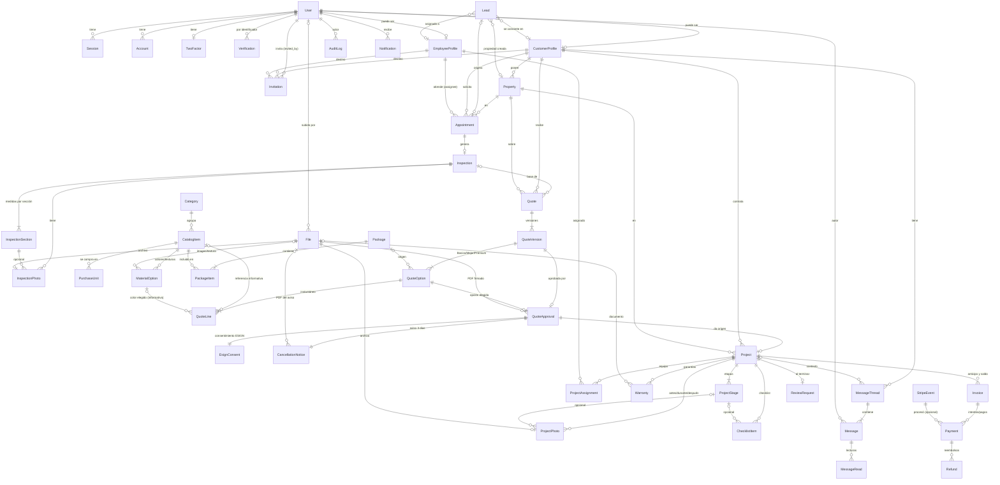

# Propuesta de modelo de datos: plataforma de roofing residencial (una sola empresa)

Estado: PROPUESTA de diseño. No hay migraciones, ni repositorio, ni base de datos tocados. Stack: PostgreSQL 18 (Neon) + Prisma. Convenciones: tablas y columnas en inglés `snake_case` (en Prisma: modelos `PascalCase` con `@@map`/`@map`), PK `id` tipo `cuid2`/`uuid` (propuesta: `uuid` v7, ordenable por tiempo), fechas `timestamptz` (UTC), dinero en centavos `Int` (`BigInt` solo en agregados de reportes), porcentajes en puntos básicos enteros (`_bps`: 7,25 % = 725), medidas en `Decimal`.

Convenciones transversales en todas las tablas de negocio: `created_at`, `updated_at`, y `deleted_at` (borrado lógico) donde se indica.

---

## 1. Diagrama entidad-relación

Entidades (38): User, Session, Account, Verification, TwoFactor, Invitation, AuditLog, CustomerProfile, EmployeeProfile, Property, Lead, Appointment, Inspection, InspectionSection, InspectionPhoto, File, Category, CatalogItem, PurchaseUnit, MaterialOption, Package, PackageItem, Quote, QuoteVersion, QuoteOption, QuoteLine, QuoteApproval, EsignConsent, CancellationNotice, Project, ProjectStage, ProjectAssignment, ProjectPhoto, ChecklistItem, Warranty, Invoice, Payment, Refund, StripeEvent, MessageThread, Message, MessageRead, Notification, ReviewRequest.

---

## 2. Entidades (campos clave)

Notación: PK = clave primaria; FK = clave foránea; UQ = único; `cents` = `Int` en centavos USD.

### 2.1 Identidad y acceso

Decisión: `User` solo es identidad y rol de autenticación. `CustomerProfile` y `EmployeeProfile` son perfiles separados con `user_id` **opcional en cliente** y **obligatorio en empleado**. Razón: el cliente nace como lead/contacto sin cuenta y se le invita después; el empleado sin cuenta no tiene sentido. Administrador y superadministrador son `User` con `role` sin perfil (si algún admin también vende o inspecciona, puede tener además `EmployeeProfile`).

| Entidad | Campos clave y restricciones | Relaciones |
|---|---|---|
| User | `email` UQ (citext, minúsculas), `name`, `role` (enum Role: CUSTOMER, EMPLOYEE, ADMIN, SUPERADMIN), `email_verified`, `two_factor_enabled`, `banned`/`status` (ACTIVE, DISABLED), `deleted_at` | 1:0..1 CustomerProfile, 1:0..1 EmployeeProfile, 1:N Session/Account |
| Session, Account, Verification, TwoFactor | Tablas de Better Auth tal cual (no se modifican; `user_id` FK con `onDelete: Cascade`) | N:1 User |
| Invitation | `email`, `role`, `token_hash` UQ (nunca el token en claro), `expires_at`, `accepted_at`, `revoked_at`, `invited_by_id` FK User, `customer_id` FK null, `employee_id` FK null. CHECK: si `role=CUSTOMER` entonces `customer_id` NOT NULL; si `EMPLOYEE`, `employee_id` NOT NULL (al aceptar se enlaza `profile.user_id` con el nuevo User) | N:1 perfil |
| AuditLog | `actor_user_id` FK null (sistema/webhook), `action`, `entity_type`, `entity_id`, `before`/`after` jsonb (sin datos sensibles), `ip`, `user_agent`, `created_at`. Solo INSERT (sin UPDATE/DELETE para el rol de la app) | N:1 User |
| CustomerProfile | `user_id` UQ null, `first_name`, `last_name`, `email`, `phone` (E.164), `preferred_contact`, `marketing_opt_in`, `deleted_at`. Índice parcial UQ `(lower(email)) WHERE deleted_at IS NULL` | 1:N Property, Quote, Project, MessageThread |
| EmployeeProfile | `user_id` UQ NOT NULL, `job_type` (enum: SALES, INSPECTOR, CREW_LEAD), `phone`, `is_active`, `deleted_at` | 1:N Appointment, ProjectAssignment |

Nota: un empleado con varios tipos de trabajo (vende e inspecciona): `job_type` como arreglo `EmployeeJobType[]` o tabla puente. Propuesta V1: arreglo de enum (Prisma lo soporta en PostgreSQL).

### 2.2 Clientes, leads, agenda, inspección

| Entidad | Campos clave y restricciones | Relaciones |
|---|---|---|
| Property | `customer_id` FK, `address_line1`, `address_line2`, `city`, `state` (char(2), CHECK en lista de estados), `zip` (CHECK `^\d{5}(-\d{4})?$`), `lat`/`lng` null, `year_built` null, `notes`, `deleted_at` | N:1 Customer; 1:N Appointment, Quote, Project |
| Lead | `status` (LeadStatus), `source` (enum: WEB_FORM, PHONE, REFERRAL, DOOR_KNOCK, OTHER) + `source_detail`, contacto en bruto (`first_name`, `last_name`, `email`, `phone`), dirección en bruto (campos de Property o `address_text`), `message`, `utm` jsonb, `assigned_to_id` FK EmployeeProfile null, `customer_id` FK null y `property_id` FK null (se llenan al convertir), `lost_reason`, `deleted_at` | N:0..1 Customer; 1:N Appointment |
| Appointment | `property_id` FK, `customer_id` FK, `lead_id` FK null, `assignee_id` FK EmployeeProfile, `type` (INSPECTION, FOLLOW_UP, ESTIMATE_PRESENTATION), `starts_at`, `ends_at` (CHECK `ends_at > starts_at`), `status` (AppointmentStatus), `cancel_reason`, `deleted_at`. EXCLUDE constraint opcional anti-doble-reserva por `assignee_id` con `tstzrange` (requiere `btree_gist`) filtrado a estados activos | N:1 Employee; 1:0..1 Inspection |
| Inspection | `appointment_id` UQ, `property_id`, `inspector_id` FK EmployeeProfile, `status` (DRAFT, COMPLETED), `completed_at`, `roof_type`/`roof_age_years` null, `findings` text, `deleted_at` | 1:N InspectionSection, InspectionPhoto |
| InspectionSection | `inspection_id`, `name` (ej. "Techo principal", "Garaje"), `area_sqft` Numeric(10,2) CHECK > 0, `pitch_rise` Numeric(4,1) (rise/12; CHECK 0..24), `ridge_ft`, `eave_ft`, `hip_ft`, `valley_ft`, `gutter_ft` Numeric(8,2) CHECK >= 0, `sort_order`, `notes` | N:1 Inspection |
| InspectionPhoto | `inspection_id`, `section_id` null, `file_id` UQ, `caption`, `taken_at` | puente tipado hacia File |

### 2.3 Archivos

| Entidad | Campos clave y restricciones |
|---|---|
| File | `bucket`, `object_key` (UQ con bucket; ruta tipo `{entity}/{id}/{uuid}.{ext}`), `mime_type`, `size_bytes` BigInt, `sha256` (hex), `original_name`, `uploaded_by_id` FK User null, `status` (PENDING, READY, DELETED), `deleted_at`. Solo metadatos: los bytes viven en R2 (URL prefirmadas de corta duración generadas por la API tras validar acceso) |

Decisión: relaciones tipadas (InspectionPhoto, ProjectPhoto, Warranty.file_id, QuoteApproval.signed_pdf_file_id) en lugar de una asociación polimórfica `entity_type/entity_id`. Mantiene integridad referencial y simplifica RLS.

### 2.4 Catálogo

| Entidad | Campos clave y restricciones |
|---|---|
| Category | `name` UQ, `kind` (MATERIAL, LABOR), `sort_order`, `is_active` |
| CatalogItem | `sku` UQ null, `name`, `kind` (MATERIAL, LABOR), `category_id`, `unit` (enum: SQUARE, LINEAR_FT, UNIT, BUNDLE), `material_price_cents` Int CHECK >= 0, `labor_price_cents` Int CHECK >= 0, `is_active`, `description`, `deleted_at`. Para kind=LABOR `material_price_cents` = 0 (CHECK) |
| PurchaseUnit | `item_id`, `name` (ej. "rollo", "caja", "paquete"), `base_units_per_purchase_unit` Numeric(10,3) CHECK > 0, `is_default`. Sirve para convertir cantidad de obra a unidades de compra (redondeo hacia arriba en la lista de materiales) |
| MaterialOption | `item_id`, `kind` (COLOR, TEXTURE), `name`, `hex` null, `texture_file_id` FK File null, `visualizer_key` null (identificador del activo del visualizador), `is_active`. UQ `(item_id, kind, name)` |
| Package | `tier` (BASIC, BETTER, PREMIUM), `name`, `description`, `is_active`. UQ parcial en `tier` para el paquete activo por defecto (o varios paquetes por tier; ver pregunta 3) |
| PackageItem | `package_id`, `item_id`, `quantity_rule` (enum: PER_SQUARE, PER_LINEAR_FT_RIDGE, PER_LINEAR_FT_EAVE, PER_LINEAR_FT_HIP, PER_LINEAR_FT_VALLEY, PER_LINEAR_FT_GUTTER, FIXED), `factor` Numeric(10,4), `default_material_option_id` null. UQ `(package_id, item_id)` |

Los cambios de precio del catálogo nunca afectan presupuestos enviados (ver 2.5).

### 2.5 Presupuesto (versiones e instantánea inmutable)

Modelo: `Quote` es el contenedor lógico (cliente+propiedad+inspección). Cada `QuoteVersion` es una revisión numerada con parámetros y tres `QuoteOption` (Básico/Mejor/Premium). `QuoteLine` es la partida calculada y congelada.

| Entidad | Campos clave y restricciones |
|---|---|
| Quote | `number` UQ legible (ej. `Q-2026-0001`, secuencia), `customer_id`, `property_id`, `inspection_id` null, `created_by_id` FK User, `current_version_id` null, `status` derivado/caché del estado de la versión vigente, `deleted_at` |
| QuoteVersion | `quote_id`, `version_number` (UQ con `quote_id`), `status` (QuoteStatus), `waste_bps` Int (ej. 1000 = 10 %), `tax_bps` Int, `deposit_bps` Int (CHECK 0..10000), `measurements_snapshot` jsonb (copia de las InspectionSection usadas), `valid_until` timestamptz, `sent_at`, `viewed_at`, `expires_at`, `pdf_file_id` null, `pdf_sha256` null, `locked_at` (se fija al enviar) |
| QuoteOption | `version_id`, `tier` (BASIC, BETTER, PREMIUM; UQ con `version_id`), `package_id` null (origen), `title`, `material_subtotal_cents`, `labor_subtotal_cents`, `waste_cents`, `tax_cents`, `total_cents`, `deposit_cents`, `balance_cents` (CHECK `deposit_cents + balance_cents = total_cents`), `selected_material_option_ids` jsonb |
| QuoteLine | `option_id`, `sort_order`, `item_id` FK null y `material_option_id` FK null (solo referencia informativa, `onDelete: SetNull`), **snapshot**: `name`, `sku`, `kind`, `unit`, `quantity` Numeric(12,3), `purchase_unit_name`, `purchase_quantity`, `unit_material_price_cents`, `unit_labor_price_cents`, `line_material_cents`, `line_labor_cents`, `line_total_cents`, `color_name`, `texture_name`. Dinero redondeado con regla fija (half-up por línea) y documentada |

Inmutabilidad: una versión con `locked_at` no admite UPDATE/INSERT/DELETE sobre sus Option/Line (trigger `BEFORE UPDATE/DELETE` que lanza excepción si el padre está bloqueado, además de validación en servicio). Para cambiar algo se crea una nueva versión (`version_number + 1`) y la anterior pasa a SUPERSEDED.

### 2.6 Aprobación, firma electrónica y aviso de cancelación

| Entidad | Campos clave y restricciones |
|---|---|
| QuoteApproval | `version_id` UQ (una aprobación por versión), `option_id` (opción elegida; debe pertenecer a `version_id`), `signer_name`, `signer_email`, `signature_file_id` null (imagen del trazo), `signed_at`, `ip` (inet), `user_agent`, `signed_pdf_file_id`, `signed_pdf_sha256` char(64), `document_version_hash`/`quote_total_cents` (copia para auditoría), `status` (SIGNED, VOIDED), `voided_at`/`void_reason`. Inmutable una vez creada salvo `status` |
| EsignConsent | `approval_id` UQ, `consent_text_version`, `consent_text_hash`, `consented_at`, `ip`, `user_agent`, `electronic_delivery_ok` bool (ESIGN §101(c): consentimiento a registros electrónicos y capacidad de acceso demostrada) |
| CancellationNotice | `approval_id` UQ, `delivered_at` NOT NULL, `delivery_method` (IN_APP, EMAIL, IN_PERSON, MAIL), `delivered_to_email`, `notice_version`, `pdf_file_id`, `acknowledged_at` null, `cancel_deadline_at` (3er día hábil: cálculo con reglas de FTC 16 CFR 429; se guarda calculado y la fórmula en servicio), `canceled_at` null, `cancel_reason`, `cancel_ip` |

Regla: el `Project` no pasa a IN_PROGRESS (inicio de obra/compra de materiales) antes de `cancel_deadline_at` salvo renuncia por emergencia documentada (ver preguntas).

### 2.7 Proyecto

| Entidad | Campos clave y restricciones |
|---|---|
| Project | `number` UQ, `approval_id` UQ (1 aprobación = 1 proyecto), `quote_version_id`, `customer_id`, `property_id`, `status` (ProjectStatus), `scheduled_start`/`scheduled_end`, `actual_start`/`actual_end`, `contract_total_cents` (copiado de la opción aprobada), `change_order_total_cents` default 0, `deleted_at` |
| ProjectStage | `project_id`, `name`, `sort_order` (UQ con project), `status` (PENDING, IN_PROGRESS, DONE, SKIPPED), `started_at`, `completed_at`. Se crean desde una plantilla de etapas (constante en código en V1) |
| ProjectAssignment | `project_id`, `employee_id`, `role` (CREW_LEAD, SALES, INSPECTOR, CREW_MEMBER), `assigned_at`, `unassigned_at` null. UQ `(project_id, employee_id)` |
| ProjectPhoto | `project_id`, `stage_id` null, `file_id` UQ, `phase` (BEFORE, DURING, AFTER), `caption`, `taken_by_id` FK Employee null, `taken_at`, `visible_to_customer` bool default true |
| ChecklistItem | `project_id`, `stage_id` null, `title`, `is_required`, `done_at`, `done_by_id` FK User null, `sort_order` |
| Warranty | `project_id`, `type` (WORKMANSHIP, MANUFACTURER), `provider_name` (la empresa o el fabricante), `product_name` null, `starts_on` date, `ends_on` date null (null = de por vida), `terms_summary`, `registration_number` null, `file_id` null, `status` (ACTIVE, EXPIRED, VOID) |

### 2.8 Facturas y pagos (Stripe)

| Entidad | Campos clave y restricciones |
|---|---|
| Invoice | `number` UQ, `project_id`, `customer_id`, `kind` (DEPOSIT, BALANCE, CHANGE_ORDER reservado), `status` (InvoiceStatus), `subtotal_cents`, `tax_cents`, `total_cents`, `amount_paid_cents` (caché; fuente de verdad = suma de Payment SUCCEEDED menos Refund), `issued_at`, `due_at`, `paid_at`, `voided_at`. UQ parcial `(project_id, kind) WHERE kind IN ('DEPOSIT','BALANCE') AND status <> 'VOID'` (una de anticipo y una de saldo activas). CHECK `amount_paid_cents BETWEEN 0 AND total_cents` |
| Payment | `invoice_id`, `status` (PaymentStatus), `amount_cents` CHECK > 0, `currency` char(3) default 'usd', `method_type` (card, us_bank_account...; solo el tipo), `card_brand`/`card_last4` **no se guardan** (se obtienen de Stripe si se necesita mostrar), `stripe_payment_intent_id` UQ, `stripe_charge_id` null, `stripe_checkout_session_id` null, `stripe_customer_id` null (en CustomerProfile o tabla aparte), `failure_code`, `paid_at`, `idempotency_key` UQ |
| Refund | `payment_id`, `amount_cents`, `stripe_refund_id` UQ, `status`, `reason`, `created_by_id` |
| StripeEvent | `stripe_event_id` UQ (clave de idempotencia), `type`, `livemode`, `received_at`, `processed_at` null, `status` (RECEIVED, PROCESSED, FAILED, IGNORED), `attempts`, `error`, `payload` jsonb (solo el objeto del evento; Stripe no envía datos de tarjeta completos). Procesamiento: `INSERT ... ON CONFLICT DO NOTHING` y se procesa solo si se insertó o si quedó en FAILED |

Nunca se guarda PAN, CVV ni fecha de vencimiento; solo IDs de Stripe y estados.

### 2.9 Comunicación y otros

| Entidad | Campos clave y restricciones |
|---|---|
| MessageThread | `customer_id`, `project_id` null, `subject`, `last_message_at`, `closed_at`. UQ parcial `(customer_id, project_id)` |
| Message | `thread_id`, `author_user_id`, `body` (límite de longitud), `file_id` null (adjunto opcional), `created_at`, `edited_at`/`deleted_at` |
| MessageRead | `message_id`, `user_id`, `read_at`; UQ `(message_id, user_id)` |
| Notification | `user_id`, `type` (enum), `title`, `body`, `entity_type`/`entity_id` (enlace profundo, sin FK), `read_at`, `created_at`. Sin envío por correo/SMS en V1 (solo dentro de la app) |
| ReviewRequest | `project_id` UQ, `customer_id`, `status` (PENDING, SENT, CLICKED, COMPLETED, DISMISSED), `sent_at`, `channel` (IN_APP, EMAIL), `review_url`, `reminder_count` |

---

## 3. Enums de estado y transiciones válidas

Las transiciones se validan en una sola función de servicio por entidad (máquina de estados) y cada cambio escribe en `AuditLog`. Los estados terminales no admiten salida.

**LeadStatus**: `NEW` → `CONTACTED` → `APPOINTMENT_SET` → `INSPECTED` → `QUOTED` → `WON`.
- `NEW|CONTACTED|APPOINTMENT_SET|INSPECTED|QUOTED` → `LOST` (con `lost_reason`).
- `NEW` → `SPAM` / `DUPLICATE`.
- `LOST` → `CONTACTED` (reabrir, solo admin).
- Terminales: `WON`, `SPAM`, `DUPLICATE`.
- Al pasar a `APPOINTMENT_SET` o antes de `QUOTED` se crea/vincula `CustomerProfile` + `Property`.

**AppointmentStatus**: `SCHEDULED` → `CONFIRMED` → `IN_PROGRESS` → `COMPLETED`.
- `SCHEDULED|CONFIRMED` → `RESCHEDULED` (crea nueva cita; la anterior queda como histórico) | `CANCELED`.
- `CONFIRMED` → `NO_SHOW`.
- Terminales: `COMPLETED`, `CANCELED`, `NO_SHOW`, `RESCHEDULED`.

**QuoteStatus** (por versión):
`DRAFT` → `SENT` → `VIEWED` → `APPROVED`.
- `DRAFT` → `SENT` (aquí se fija `locked_at` y se congela la instantánea + PDF + hash).
- `SENT|VIEWED` → `DECLINED` | `EXPIRED` (por `valid_until`) | `SUPERSEDED` (se creó versión nueva).
- `SENT|VIEWED` → `APPROVED` (solo vía QuoteApproval válida).
- `APPROVED` → `VOIDED` (solo si el aviso de cancelación fue ejercido; ver CancellationNotice).
- Terminales: `APPROVED` (salvo `VOIDED`), `DECLINED`, `EXPIRED`, `SUPERSEDED`, `VOIDED`.

**ProjectStatus**: `PENDING_START` (aprobado, esperando fin de los 3 días y anticipo) → `SCHEDULED` → `IN_PROGRESS` → `PUNCH_LIST` (pendientes) → `COMPLETED` → `CLOSED` (saldo pagado + garantías emitidas).
- `PENDING_START|SCHEDULED` → `CANCELED` (cancelación dentro de los 3 días o acuerdo).
- `IN_PROGRESS` ↔ `ON_HOLD` (clima, materiales, pago).
- `COMPLETED` → `IN_PROGRESS` (reapertura por garantía/pendientes, solo admin).
- Terminales: `CLOSED`, `CANCELED`.

**InvoiceStatus**: `DRAFT` → `ISSUED` → `PARTIALLY_PAID` → `PAID`.
- `ISSUED|PARTIALLY_PAID` → `OVERDUE` (por fecha; puede volver a `PARTIALLY_PAID`/`PAID`).
- `DRAFT|ISSUED` → `VOID`.
- `PAID` → `REFUNDED` (total) o se mantiene `PAID` con reembolso parcial registrado (decisión por `amount_paid_cents`).
- Terminales: `PAID` (salvo reembolso), `VOID`, `REFUNDED`.

**PaymentStatus** (espejo de Stripe, nunca decidido por el cliente): `PENDING` → `PROCESSING` → `SUCCEEDED`.
- `PENDING|PROCESSING` → `FAILED` | `CANCELED` | `REQUIRES_ACTION` (3DS) → `PROCESSING`.
- `SUCCEEDED` → `PARTIALLY_REFUNDED` → `REFUNDED`; `SUCCEEDED` → `DISPUTED` (si se agrega gestión de disputas; ver V2).
- Terminales: `FAILED`, `CANCELED`, `REFUNDED`.
- Solo el webhook (verificado por firma) lleva un pago a `SUCCEEDED`; el retorno del navegador solo lee el estado.

---

## 4. Integridad, índices, borrado lógico y control de acceso

### 4.1 Reglas de integridad
- Dinero: `Int` en centavos, CHECK `>= 0` en precios/totales; sin `Float`/`Decimal` para dinero. Porcentajes en `_bps` enteros. Cantidades y medidas en `Numeric`.
- Totales coherentes: CHECK `deposit_cents + balance_cents = total_cents`; la suma de `QuoteLine.line_total_cents` = subtotales de `QuoteOption` (verificado en el servicio dentro de la misma transacción al enviar).
- Inmutabilidad por trigger de las versiones enviadas (ver 2.5), de `QuoteApproval`/`EsignConsent`/`CancellationNotice` (solo columnas de estado editables) y de `AuditLog` (append-only: `REVOKE UPDATE, DELETE`).
- Unicidad: `Invoice` activa por `(project_id, kind)`; `Payment.stripe_payment_intent_id`, `StripeEvent.stripe_event_id`, `QuoteApproval.version_id`, `Project.approval_id`, `Inspection.appointment_id`.
- `onDelete`: `Restrict` por defecto en entidades de negocio (nada se borra en cascada); `Cascade` solo en hijos propios sin valor independiente (InspectionSection, QuoteOption/QuoteLine, Session/Account). Referencias del snapshot a catálogo son `SetNull`.
- Todas las fechas `timestamptz`; la zona horaria de la empresa solo se aplica al mostrar y al calcular plazos (plazo de 3 días hábiles).
- Estados guardados como enums PostgreSQL (Prisma `enum`); alta de valores con migración aditiva.

### 4.2 Índices principales
- Cliente: `Property(customer_id)`, `Quote(customer_id, created_at DESC)`, `Project(customer_id, status)`, `Invoice(customer_id, status)`, `MessageThread(customer_id, last_message_at DESC)`.
- Estado y fecha (todos con `status` + fecha): `Lead(status, created_at DESC)`, `Appointment(status, starts_at)`, `Quote`/`QuoteVersion(status, sent_at)`, `Project(status, scheduled_start)`, `Invoice(status, due_at)` (cobros vencidos), `Payment(status, created_at)`.
- Empleado asignado: `Appointment(assignee_id, starts_at)`, `Inspection(inspector_id, status)`, `ProjectAssignment(employee_id, project_id)` (índice inverso del UQ), `Lead(assigned_to_id, status)`.
- Parciales (solo filas activas): `... WHERE deleted_at IS NULL` en tablas con borrado lógico; `Invoice(due_at) WHERE status IN ('ISSUED','PARTIALLY_PAID')`; `Notification(user_id, created_at DESC) WHERE read_at IS NULL`; `Invitation(email) WHERE accepted_at IS NULL AND revoked_at IS NULL`.
- Búsqueda: `CustomerProfile` por nombre/email/teléfono con `pg_trgm` GIN (opcional V1); `lower(email)`.
- Auditoría: `AuditLog(entity_type, entity_id, created_at DESC)` y `AuditLog(actor_user_id, created_at DESC)`; particionar por mes cuando crezca (V2).
- Regla de trabajo: cada índice debe justificarse con una consulta real y comprobarse con `EXPLAIN (ANALYZE, BUFFERS)` sobre datos sembrados antes de crearlo.

### 4.3 Borrado lógico
Con `deleted_at`: User, CustomerProfile, EmployeeProfile, Property, Lead, Appointment, Inspection, CatalogItem, Quote, Project, File, Message. Sin borrado (inmutables o históricos; solo se anulan por estado): QuoteVersion/Option/Line, QuoteApproval, EsignConsent, CancellationNotice, Invoice (`VOID`), Payment, Refund, StripeEvent, AuditLog. La eliminación física de datos personales (solicitud de privacidad) se hace por proceso administrativo de anonimización, conservando facturas, firmas y auditoría por obligación legal/contable.

### 4.4 Control de acceso por fila
Defensa en dos capas; la segunda es la garantía real.

1. **Capa API (obligatoria)**: toda consulta pasa por un servicio que recibe el `AuthContext {user_id, role, customer_id?, employee_id?}` y aplica un filtro de alcance centralizado (no a mano en cada endpoint): cliente → `customer_id = ctx.customer_id`; empleado → solo filas ligadas a sus citas/proyectos asignados; admin/superadmin → todo (superadmin además gestiona usuarios, roles, catálogo y ajustes sensibles). Se prohíben IDs consecutivos; las respuestas 404 (no 403) cuando el recurso existe pero no es visible.
2. **RLS en PostgreSQL (defensa en profundidad)**:
   - Rol de base `app_user` **sin** `BYPASSRLS` y sin ser dueño de las tablas (el dueño/migraciones usa otro rol). `ENABLE` + `FORCE ROW LEVEL SECURITY` en toda tabla con datos de personas.
   - Cada petición abre una transacción y ejecuta `SELECT set_config('app.user_id', $1, true), set_config('app.role', $2, true)` (`is_local = true`) mediante una extensión del cliente Prisma; así funciona con el pooler de Neon en modo transacción (no usar `SET` de sesión).
   - Funciones auxiliares `STABLE` y `SECURITY INVOKER` en un esquema privado: `app.current_user_id()`, `app.current_role()`, `app.current_customer_id()`, `app.current_employee_id()` (resuelven el perfil por `user_id`). Las políticas usan `(select app.current_customer_id())` para que el planificador lo evalúe una sola vez.
   - Políticas tipo (por operación, con `USING` y `WITH CHECK` en escritura):
     - Admin/Superadmin: `USING (app.current_role() IN ('ADMIN','SUPERADMIN'))`.
     - Cliente en `Property/Quote/Project/Invoice/Payment/MessageThread/...`: `customer_id = app.current_customer_id()`; tablas hijas (QuoteOption/QuoteLine, Inspection fotos, ProjectStage...) mediante `EXISTS` contra el padre (o `customer_id` desnormalizado en hijas críticas para evitar joins en la política). El cliente **no** ve inspecciones internas, notas internas ni `ProjectPhoto.visible_to_customer = false`.
     - Empleado: `Appointment.assignee_id = app.current_employee_id()`; `Project` y sus hijas vía `EXISTS (SELECT 1 FROM project_assignment pa WHERE pa.project_id = ... AND pa.employee_id = app.current_employee_id() AND pa.unassigned_at IS NULL)`; `Inspection.inspector_id`; `Lead.assigned_to_id`. Escritura limitada a sus fotos, checklist y estados de etapa. Sin acceso a `Invoice`, `Payment` ni precios de costo/mano de obra salvo decisión contraria (pregunta 6).
     - `Notification`/`Session`: `user_id = app.current_user_id()`. `Message`: visible si el hilo es visible.
     - Catálogo: lectura para autenticados (cliente ve solo `MaterialOption` activas del visualizador, no costos); escritura solo admin.
     - `AuditLog`: INSERT para todos los roles; SELECT solo admin/superadmin.
   - Webhooks de Stripe y tareas internas usan un rol de servicio distinto (`app_system`) con políticas explícitas por tabla, nunca el superusuario.
   - Pruebas automatizadas de RLS (matriz rol × tabla × operación) en CI contra un Postgres efímero antes de cada despliegue.
3. **Archivos**: el acceso a objetos de R2 siempre vía URL prefirmada de vida corta emitida tras consultar la fila `File` bajo RLS; el bucket es privado.

---

## 5. Alcance por versión

### V1 (primera versión)
- Identidad completa (User/Session/Account/Verification/TwoFactor/Invitation/AuditLog) + CustomerProfile, EmployeeProfile, Property.
- Lead (formulario web y alta manual), Appointment, Inspection con InspectionSection y fotos, File (R2).
- Catálogo completo (Category, CatalogItem, PurchaseUnit, MaterialOption, Package, PackageItem).
- Quote/QuoteVersion/QuoteOption/QuoteLine con instantánea inmutable, PDF y hash; QuoteApproval, EsignConsent, CancellationNotice.
- Project, ProjectStage, ProjectAssignment, ProjectPhoto, ChecklistItem, Warranty.
- Invoice (anticipo/saldo), Payment, StripeEvent (webhooks idempotentes); Refund (solo registro de reembolsos hechos desde Stripe).
- MessageThread/Message/MessageRead, Notification (en la app), ReviewRequest.
- RLS completo + pruebas de RLS.

### Preparado para después (sin construir ahora; el modelo no lo bloquea)
- Órdenes de cambio (`Invoice.kind = CHANGE_ORDER`, `Project.change_order_total_cents`) y tabla `ChangeOrder`.
- Disputas/chargebacks (`PaymentStatus.DISPUTED` reservado), pagos a plazos/financiamiento. (ACH entra en V1 junto con tarjeta, vía Stripe en modo de prueba: `method_type = us_bank_account`.)
- Lista de materiales y compras a proveedores (PurchaseUnit ya convierte cantidades), inventario, costos reales y rentabilidad por proyecto.
- Notificaciones por correo/SMS/push (Notification ya es la bandeja base), plantillas.
- Disponibilidad avanzada y calendario externo (Google/Outlook), múltiples asignados por cita, rutas.
- Visualizador de techos (los campos `MaterialOption.visualizer_key`/`texture_file_id` ya existen).
- Particionado de AuditLog, búsqueda de texto completo, reportes/BI en réplica de lectura.
- Multiempresa (tenant): hoy no hay `company_id`; si se necesitara, se añadiría con migración aditiva y RLS por tenant.

---

## 6. Preguntas para el usuario

1. Plazo del aviso de 3 días (FTC 16 CFR 429): ¿se firma siempre en el domicilio del cliente o también en línea sin visita? Cambia el texto legal y quién entrega el aviso (el modelo ya registra método y fecha de entrega). Además, ¿se permite iniciar obra antes del tercer día (renuncia por emergencia)? Eso exige un campo de renuncia firmada por separado y revisión legal.
2. ¿En qué estados opera? Requisitos de licencia de contratista, textos de garantía/derecho de cancelación y plazos estatales (algunos estados más estrictos que el federal) pueden añadir campos (número de licencia, avisos de gravamen/lien).
3. Paquetes Básico/Mejor/Premium: ¿son tres plantillas fijas globales o puede haber varios paquetes por nivel (por tipo de techo: shingle, metal, tejas)? Define si `Package.tier` es único.
4. Impuesto: ¿una sola tasa configurable, o por condado/ciudad según propiedad, y se aplica a material, mano de obra o ambos (en muchos estados la mano de obra de reparación y de mejoras tiene tratamiento distinto)?
5. Anticipo: ¿porcentaje fijo (ej. 50 %) o variable por presupuesto? ¿Se cobra el saldo al terminar siempre o hay pagos por etapas (draws)? Hoy se modela anticipo + saldo según lo aprobado.
6. Empleados: ¿el equipo de campo (jefe de cuadrilla) debe ver precios del presupuesto y facturas, o solo medidas, fotos, checklist y etapas? Propuesta: solo lo operativo.
7. Aprobación del cliente: ¿puede firmar una persona distinta del titular (cónyuge, apoderado)? ¿Se requiere un segundo firmante (coprop.)? Afecta si `QuoteApproval` admite varios firmantes.
8. Retención y privacidad: ¿cuántos años se conservan fotos, PDFs firmados y registros? (para definir políticas de ciclo de vida en R2 y anonimización).
9. Reseñas: ¿solo se envía el enlace (Google, etc.) o se registra la calificación dentro de la plataforma? El modelo actual solo guarda la solicitud y su estado.
10. ¿Quién puede cambiar precios del catálogo y crear presupuestos con descuentos (administrador solamente o también ventas)? Si hay descuentos, falta un campo `discount_cents`/`discount_bps` por versión, que se podría añadir ahora.

---

## 7. Decisiones aprobadas (12-nov-2026)

Respuestas a las preguntas de la sección 6, aprobadas por el usuario como valores por defecto (configurables):

| # | Tema | Decisión |
|---|---|---|
| 1 | Aviso de 3 días | Se entrega siempre, firme el cliente en persona o en línea. Sin renuncia por emergencia en V1. |
| 2 | Estado y licencia | Número de licencia y estado en la configuración de la empresa; reglas estatales cuando se conozca el estado. |
| 3 | Paquetes | Varios paquetes por nivel (`Package.tier` no es único). |
| 4 | Impuesto | Una tasa configurable sobre materiales; opción para aplicarla también a la mano de obra. |
| 5 | Anticipo | Porcentaje por defecto configurable y editable por presupuesto. Solo anticipo y saldo en V1. |
| 6 | Visibilidad de empleados | Cuadrilla: solo lo operativo. Ventas: precios de sus propios presupuestos. Sin acceso a facturas ni pagos. |
| 7 | Firmantes | Un firmante por presupuesto en V1. |
| 8 | Retención | 7 años por defecto, configurable (validar con contador o abogado). |
| 9 | Reseñas | Solo se envía el enlace; no se guardan calificaciones. |
| 10 | Precios y descuentos | Solo administración modifica el catálogo. Se añade `discount_bps` en `QuoteVersion`, aplicable solo por administración. |
